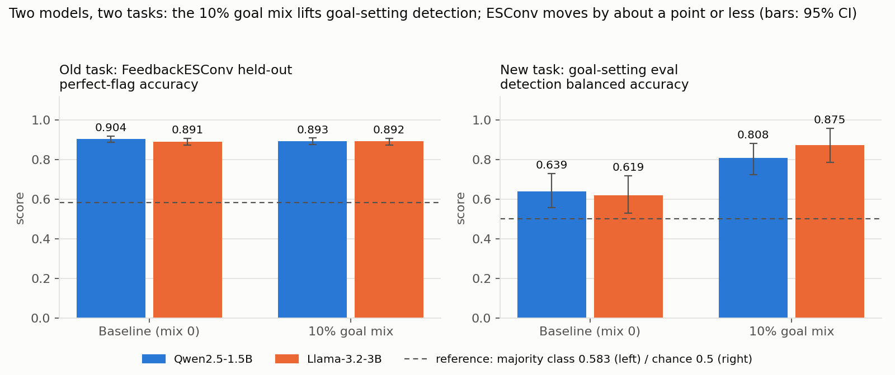
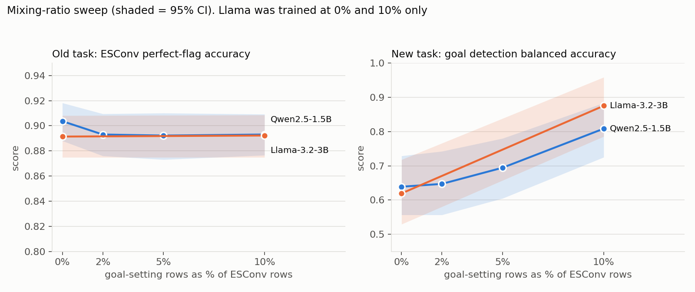
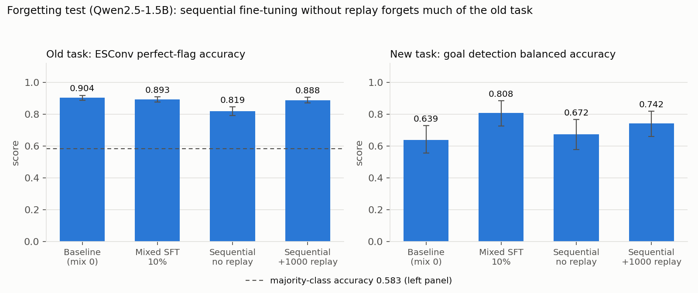
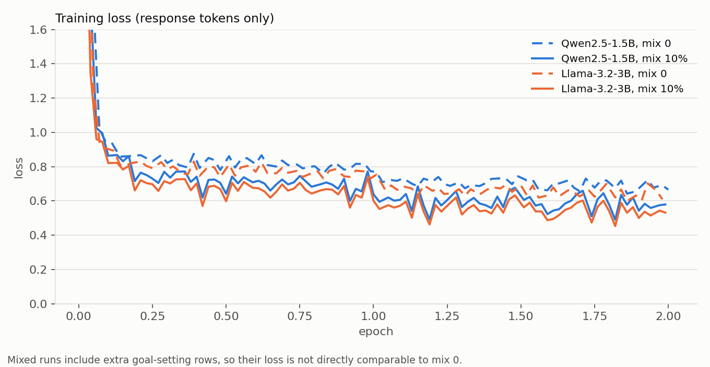

# BRIDGE-AI trial: goal-setting / homework feedback

Measures, then reduces, the feedback model's blind spot around goal-setting and homework (behavioral activation), without losing performance on the FeedbackESConv held-out test. Start with [SUMMARY.md](SUMMARY.md) for results and caveats.

Models: `Qwen/Qwen2.5-1.5B-Instruct` and `meta-llama/Llama-3.2-3B-Instruct` (gated; needs an HF token in the Modal secret `huggingface-secret`). LoRA SFT, loss on the response only, trained on Modal (A10G).

## Scope and time
This trial was completed in about one day (24-25 Nov 2026), so it is deliberately small. The exercise names Llama-3.1-8B-Instruct; the team's reply allowed a ~2B-class model as a fallback, and the credit budget was limited, so I trained **two small models** instead and compared them:

| | Qwen2.5-1.5B-Instruct | Llama-3.2-3B-Instruct |
|---|---|---|
| Runs trained | held-out baseline, original (all data), mixes 2/5/10%, sequential with and without replay | held-out baseline, mix 10% |
| ESConv perfect-acc, baseline / mix 10% | 0.904 / 0.893 (-0.011, significant) | 0.891 / 0.892 (+0.001, n.s.) |
| Goal detection bal-acc, baseline / mix 10% | 0.639 / 0.808 | 0.619 / 0.875 |
| Goal detection gain (paired bootstrap) | +0.169 (significant) | +0.256 (significant) |
| ESConv ROUGE-L, baseline / mix 10% | 0.392 / 0.395 | 0.439 / 0.447 |

**Why these two models:** Qwen2.5-1.5B is the starter kit's default ungated model, matches the ~2B fallback the team allowed, and was cheap enough for the full sweep (mixes, original, sequential). Llama-3.2-3B is the closest Llama I could actually use: the exercise names Llama-3.1-8B, but my access to it was not approved in time (403) and the shared Modal credit (about $9 left) made an 8B fine-tune too risky. Using one model from each family also lets the comparison show whether the result depends on the model. It does not show that bigger is better, because the two were not trained identically (Llama only at mix 0 and 10%).

Llama-3.2-3B reaches the higher goal-detection score and shows no significant ESConv change, but the two models' confidence intervals overlap, so "the bigger model is better" is **not** established. Everything is one greedy sample per prompt on a 110-item eval set with 20 positives; read SUMMARY.md section 5 before trusting the numbers. No Llama-3.1-8B, DPO or separate-LoRA runs were done.

## Results at a glance
All figures are drawn from `results/generations/` and `results/logs/` by `src/make_figures.py`.

**Both models, both tasks** (old task = FeedbackESConv held-out, new task = goal-setting eval):


**Mixing-ratio sweep:**


**Forgetting test (Qwen2.5-1.5B), mixed SFT vs sequential fine-tuning:**


**Training loss for the four main runs:**


The full table with every metric is in [results/table.md](results/table.md) and SUMMARY.md section 2.

## LLM-as-judge: what was and was not done
- **No Anthropic API judge was run** (`src/judge.py` exists but needs an `ANTHROPIC_API_KEY`, which I did not have). Instead two Claude passes scored the same blinded outputs (rubric 0-2 per item): a first pass by the Claude Code assistant I worked with, and a **second pass by fresh Claude sessions with no shared context** that saw only the rubric and the blinded items (no model names, keys or earlier scores).
- Columns are Qwen baseline / Qwen mix 10% / Llama baseline / Llama mix 10%.

| Judged | n | first pass | fresh-session judge |
|---|---|---|---|
| Goal eval: diagnosis names the injected flaw | 48 | 0.17 / 1.50 / 0.17 / 2.00 | 0.17 / 1.50 / 0.17 / 2.00 |
| Goal eval: quality of suggested alternative | 48 | 0.00 / 1.25 / 0.00 / 1.92 | 0.00 / 1.25 / 0.00 / 1.83 |
| ESConv: agreement with gold expert critique | 64 | 1.31 / 1.38 / 1.31 / 1.44 | 1.38 / 1.62 / 1.38 / 1.50 |

The two passes agree closely (goal diagnosis 48/48 identical; alternative 45/48; ESConv 53/64, always within one point; weighted kappa 0.87-1.00). Caveats: both are the same model family, so this is not independence in the human-rater sense and **not** Cohen's kappa against expert labels (which the exercise asks for and I did not do); items are few (16 per run on ESConv), so ESConv differences between runs are not meaningful. Protocol, scores and details: `results/judging/` (`fresh_judge_summary.md`).
- **Expert validation is prepared but not done.** Blinded rating sheets, expert instructions, a pre-set decision rule and the kappa script are in `expert_validation/` and `docs/expert_validation_protocol.md`; no expert has rated anything yet. Note the 48-item goal sample contains only degraded responses (no strong ones, no negative controls), so it can validate diagnosis/alternative scoring, not detection.

## Layout
```
bridge/
├── SUMMARY.md              results, two-axis table, limitations
├── README.md               this file
├── src/                    pipeline code (run everything from this folder, bridge/)
│   ├── make_split.py       split FeedbackESConv by conversation -> ../data/feedback_qesconv_labeledsplit
│   ├── scenarios_eval.py   eval scenarios (do not edit after seeing results)
│   ├── scenarios_train.py  train scenarios (disjoint from eval)
│   ├── build_data.py       builds data/goal_eval_set.json + data/goal_train.json (asserts eval/train disjoint)
│   ├── core.py             LoRA SFT + generation (P(perfect) from next-token probs)
│   ├── bridge_modal.py     Modal entrypoints: train, gen, seq (sequential fine-tuning)
│   ├── metrics.py          ESConv + goal-eval metrics (area F1, BLEU/ROUGE/BERTScore, detection, pairwise)
│   ├── judge.py            optional LLM judge (needs ANTHROPIC_API_KEY)
│   ├── make_table.py       two-axis results table
│   ├── paired_bootstrap.py paired cluster-bootstrap significance vs a baseline
│   ├── extra_analysis.py   AUC, shortcut check, contamination check
│   ├── judge_agreement.py  kappa + bootstrap CI between two raters (judge vs expert)
│   └── make_figures.py     figures for this README
├── data/                   goal_eval_set.json (110 items), goal_train.json (116 rows)
├── docs/                   rubric.md, expert_validation_protocol.md, POLL.md (familiarity poll)
├── expert_validation/      blinded rating sheets (goal 48 items, ESConv 64 items) for an expert to fill in
├── results/
│   ├── generations/        raw model outputs per run: <run>_esconv.json, <run>_goal.json
│   ├── bertscore/          per-run BERTScore
│   ├── judging/            manual (Claude-as-judge) scores and heuristic agreement
│   ├── logs/               Modal train_* / gen_* logs per run
│   ├── figures/            fig1-fig4 PNGs used in this README
│   ├── table.md, text_metrics_table.md, paired_bootstrap.txt, extra_analysis.md
└── tests/                  smoke_test.py (CPU plumbing check), test_judge_agreement.py
```

## Reproduce
```bash
pip install modal numpy sacrebleu rouge-score bert-score tokenizers transformers
modal setup
python src/make_split.py          # 340 train / 60 test conversations
python src/build_data.py          # regenerates data/*.json (deterministic)

modal run src/bridge_modal.py::train --run-name sft_mix0 --mix 0.0           # held-out baseline
modal run src/bridge_modal.py::gen   --run-name sft_mix0                     # -> results/generations/sft_mix0_{esconv,goal}.json
modal run src/bridge_modal.py::train --run-name orig_all --use-all true      # "original" model: all labeled data
for m in 0.02 0.05 0.10; do modal run src/bridge_modal.py::train --run-name sft_mix$m --mix $m; modal run src/bridge_modal.py::gen --run-name sft_mix$m; done
modal run src/bridge_modal.py::train --run-name llama_mix0.10 --mix 0.10 --model-name meta-llama/Llama-3.2-3B-Instruct
modal run src/bridge_modal.py::seq --base-run sft_mix0 --run-name seq_replay1000 --replay-n 1000

python src/make_table.py
python src/paired_bootstrap.py sft_mix0 sft_mix0.02 sft_mix0.05 sft_mix0.10    # first name = baseline
python src/extra_analysis.py
python src/make_figures.py        # -> results/figures/
python tests/smoke_test.py
python tests/test_judge_agreement.py
```
`mix` = (#goal rows)/(#ESConv rows); the 116 goal rows are repeated to reach the ratio. Numbers in `results/` were produced by these scripts; the manual-judge files in `results/judging/` come from a blinded review done outside the repo scripts.

## Known limitations
- Eval and training data are template-composed (controlled one-flaw degradations), not expert-written or expert-reviewed; train and eval share a generator style, so gains probably overstate real-world generalisation.
- One greedy sample per prompt; 1.5B/3B models rather than Llama-3.1-8B; the LLM judge is unvalidated against experts. Details in SUMMARY.md section 5.
- `sft_mix0` was trained with batch 8 x accumulation 2; later runs with 4 x 4 (same effective batch) after an out-of-memory crash.
